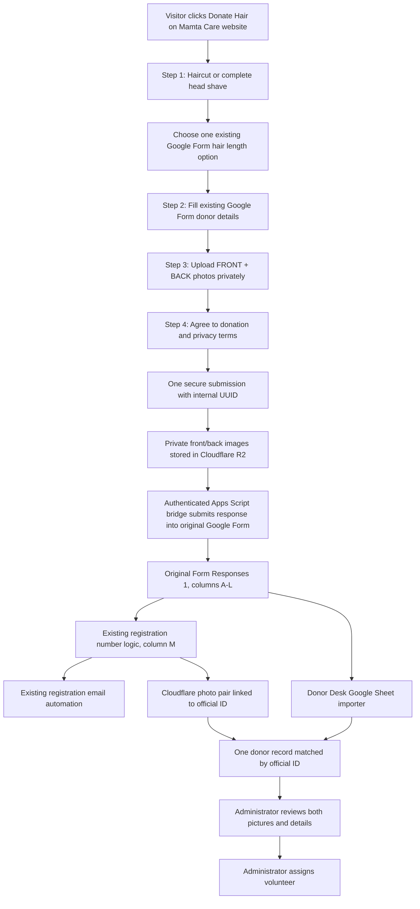

# Mamta Care — integrated hair donation registration

## Hard requirements
* Donor never opens Google Form separately and never enters a registration ID.
* Register directly on the site's /hair-registration route in four short steps.
* Form responses are sent **through original Google Form**, never an independent donor database insert.
* Use exact existing Form Responses 1 choices: 14-16INCHES; 18-20INCHES; 21-26INCHES; BALD(FULL LENGTH). A new 17-18 inch category requires updating the actual Google Form first; the website must not silently invent it.
* At least 14 usable inches excluding split ends and uneven ends for haircut; voluntary full head shave is highlighted as recommended.
* Exactly two photos, front and back, JPEG/PNG/WebP, each max 4 MiB, encrypted-in-transit and privately stored.
* Website consent must not imply permission to publish donor photographs. Keep publicity consent optional.
* Both server-side launch gates remain off until the Apps Script auth, original email, Google Sheet import, secure photo display, and idempotency are tested end to end.
* Official approved logo is unchanged; instructional images are examples, not claimed real donors, and do not depict invented logo uniforms.
* Google Form's existing options are the authority; preserve original email workflow and staff/admin permissions.
* Prevent duplicate submissions and support administrator reconciliation of interrupted registrations.
* Admin photo access must require existing Donor Desk authentication and authorization. No public R2 object URLs.

## Current blockers
1. The deployed Apps Script route rejects server-to-server requests from this environment with HTTP 403, so backend authentication is not validated.
2. Original Apps Script flow must be validated by an authorized test that proves its FormApp submission produces an ID and email.
3. Authenticated Donor Desk photo viewer for front/back images must be built/tested on the original Donor Desk worker.
4. Automated Google Sheet import must be verified to create a single donor record.

Do not activate without resolving these blockers.
